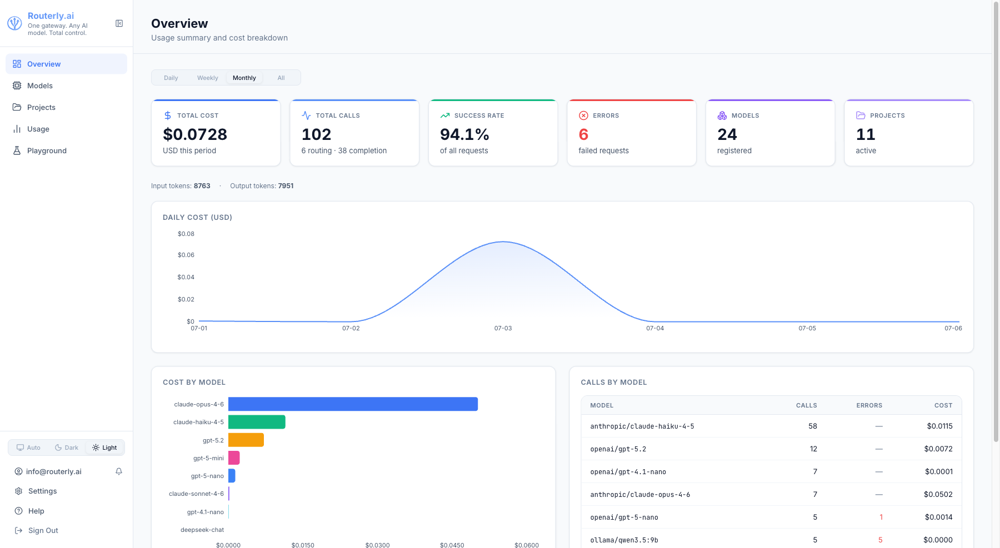
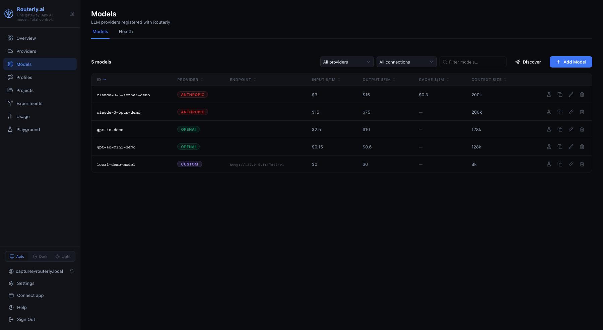
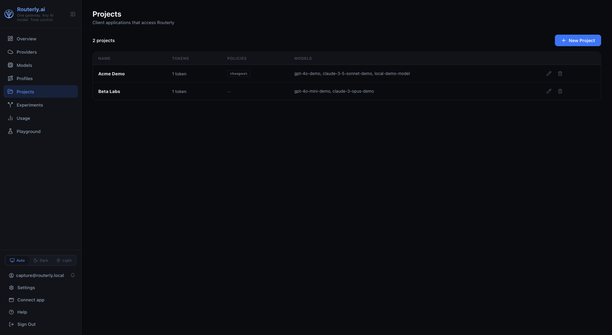
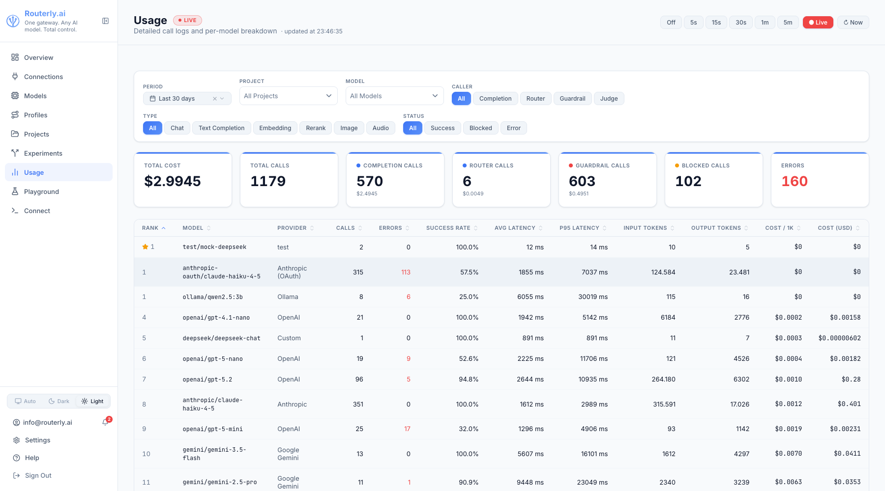
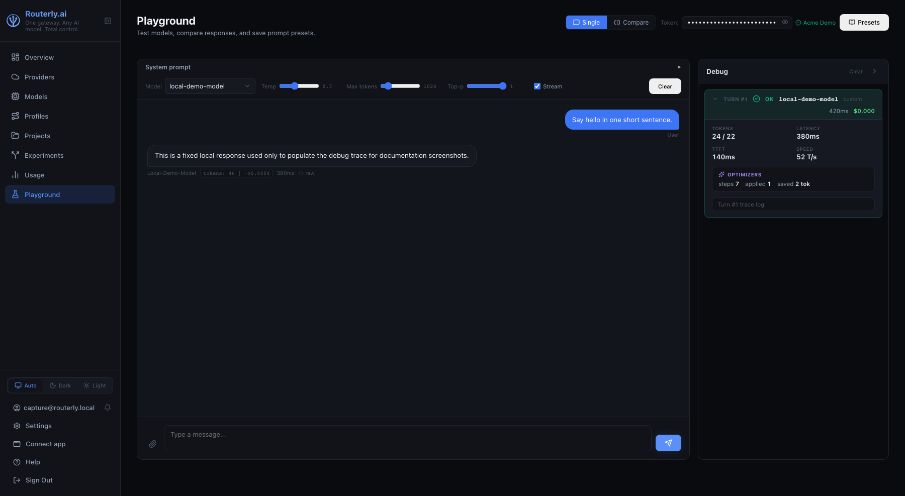

<div align="center">
  
  <h1>Routerly</h1>
  <p><strong>One gateway. Any AI model. Total control.</strong></p>

  <p>
    The self-hosted decision and control layer for your LLM providers: composable routing policies with explainable decisions, governance (roles, budgets, audit), and wire-format transparency.<br>
    Compatible with the OpenAI and Anthropic APIs: change the base URL, nothing else.
  </p>
  <p>
    <a href="https://www.routerly.ai/">https://www.routerly.ai/</a>
  </p>
  <p>
    
    
    
    
    <a href="https://hub.docker.com/r/inebrio/routerly"></a>
    
    
    <a href="https://cla-assistant.io/Inebrio/Routerly"></a>
    
    
    
  </p>
</div>

---

## Quick Start

**macOS / Linux:**
```bash
curl -fsSL https://www.routerly.ai/install.sh | bash
```

**Windows (PowerShell):**
```powershell
powershell -c "irm https://www.routerly.ai/install.ps1 | iex"
```

**Docker:**
```bash
docker run -d \
  --name routerly \
  -p 3000:3000 \
  -v routerly_data:/data \
  -e ROUTERLY_HOME=/data \
  --restart unless-stopped \
  inebrio/routerly:latest
```

Then:

1. Open `http://localhost:3000/dashboard` and create the admin account (first-run Setup screen).
2. Log in from the CLI, register a model, create a router and attach the model:

```bash
routerly auth login --url http://localhost:3000 --email you@example.com
routerly model add --id gpt-5-mini --provider openai --api-key sk-YOUR_KEY
routerly router create --name "My App"        # prints the router token (sk-rt-…), shown once
routerly router model add "My App" gpt-5-mini
```

3. Point your client at `http://localhost:3000/v1` (OpenAI format) or `http://localhost:3000` (Anthropic format) and use the router token as the API key.

If the service is not running (for example after a source build), start it with `routerly start`.

**Learn more:** [Quick Start tutorial](docs/getting-started/quick-start.md) — [Installation options and update channels](docs/getting-started/installation.md) — [Dashboard guide](docs/dashboard/overview.md) — [CLI reference](docs/cli/commands.md)

---

## What Routerly is

Routerly sits between your applications and your LLM providers. It is the layer that **decides** where each request goes and **controls** who may send what, while staying invisible to the client.

- **Decide**: composable routing policies score every candidate model, and every decision can be explained (routing trace, Playground, per-call usage records). Routing is one function of the layer, not the whole of it.
- **Control**: roles and permissions, per-router and per-token budgets, guardrails, PII scrubbing, audit log, notifications.
- **Stay transparent**: clients change only the base URL. Routerly adds no custom headers and no non-standard fields, and returns the provider's response as it received it. The only payload changes are the ones you switch on yourself (PII scrubbing, guardrail steering, token optimizers), each off unless configured.

No database and no Redis: configuration lives in JSON files.

---

## Capabilities

- **Routers, orchestrators and passthrough.** A *router* scores models with routing policies. An *orchestrator* forwards to a priority-ordered list of other routers. A *passthrough* router forwards a client's own credential straight to OpenAI or Anthropic (optionally alongside real target models).
- **11 routing policies**, combined into one ranking (table below), plus **routing profiles**: reusable presets for routing, optimizers and security. Four built-in routing profiles (`auto`, `cheap`, `fast`, `coding`), clonable.
- **Budgets and cost tracking.** Every request is priced per token; hard limits (hourly, daily, weekly, monthly, yearly and rolling windows) at global, router and token level block overspending before the call.
- **Guardrails and PII scrubbing.** Rule-based and judge-based content guardrails, and PII policies, on requests, responses, or both.
- **8 token optimizers** (`session-dedup`, `ccr`, `rtk`, `headroom`, `json-table`, `relevance`, `caveman`, `llmlingua-2`), off by default, enabled per router.
- **Experiments.** A/B test whole routers against each other (model sets, profiles, optimizer pipelines, guardrails) without any client change.
- **Resilience.** Automatic fallback to the next candidate on provider errors or timeouts.
- **Roles and permissions.** Custom roles over 26 granular permissions, per-user two-factor authentication, router members.
- **Audit log** of management actions.
- **Notifications** to the in-app inbox, email (SMTP, SES, SendGrid, Azure, Google) and webhooks (generic, Slack, Teams, PagerDuty, Discord).
- **MCP server.** Personal MCP tokens let Claude Code, Cursor, Cline and other MCP clients inspect and adjust Routerly with your own permissions.
- **Dashboard, CLI and API.** Every function is available in all three; the dashboard also has a Playground with routing trace and cost breakdown.
- **Updates.** Built-in update check against GitHub Releases; channels `latest`, `current`, `next`, `develop`; update with `routerly update run` or from the dashboard.

### Routing policies

Policies run in order; each filters or scores the candidates, and the highest combined score wins. A failed call falls back to the next candidate.

| Policy | What it does |
|--------|-------------|
| `llm` | Asks a language model to pick the best candidate given the request |
| `semantic-intent` | Classifies the request intent with embeddings and prefers models suited to it |
| `model-preference` | Prefers the model the client named; abstains when the client sends the virtual model `routerly/ada` |
| `cheapest` | Minimises estimated cost |
| `health` | Deprioritises models with recent errors |
| `performance` | Favours models with lower observed latency |
| `capability` | Matches models to task requirements (vision, tools, JSON mode, thinking) |
| `context` | Filters models by context window versus prompt size |
| `budget-remaining` | Excludes models that would push a router over its budget |
| `rate-limit` | Steers traffic away from rate-limited providers |
| `fairness` | Balances load across candidates |

---

## How Routerly compares

Last verified: 2026-10-21, against each project's public README and documentation at that date. "n/v" means not verifiable from public documentation.

| | **Routerly** (0.5.x) | **LiteLLM** proxy | **Bifrost** | **Portkey** OSS gateway | **OpenRouter** |
|---|---|---|---|---|---|
| Self-hosted | ✅ | ✅ | ✅ | ✅ | ❌ hosted service |
| Open source | AGPL-3.0 | open core, enterprise features under a commercial license | Apache-2.0 (enterprise tier exists) | MIT (hosted/enterprise tier exists) | n/a |
| OpenAI-compatible API | ✅ | ✅ | ✅ | ✅ | ✅ |
| Anthropic Messages API (`/v1/messages`) | ✅ | ✅ | ✅ (`/anthropic`) | n/v | n/v |
| Database for core use | none (JSON files) | PostgreSQL recommended for production; virtual keys and spend tracking use it | n/v | n/v | n/a |
| Routing | 11 composable policies, profiles, orchestrators | fallback, weighted, latency, cost, usage, least-busy strategies | routing rules, key/provider load balancing, fallbacks | fallbacks, retries, weighted load balancing | n/v |
| LLM- or intent-based routing | ✅ (`llm`, `semantic-intent`) | n/v | n/v | n/v | n/v |
| Budgets / spend control | ✅ global, router, token | ✅ spend tracking and limits per key/team/user | ✅ virtual keys, teams, customers | n/v | n/v |
| Guardrails | ✅ built in (rules, judge, PII) | ✅ | enterprise tier | ✅ input/output checks (PII redaction listed as enterprise) | n/v |
| Token optimizers | ✅ 8, opt-in | n/v | n/v | n/v | n/v |
| MCP | management MCP server (not a tool gateway) | MCP gateway | MCP client and server | MCP gateway (separate product) | n/v |
| Roles and permissions | ✅ custom roles, 26 permissions | n/v (SSO listed as enterprise) | enterprise tier | n/v | n/v |
| SSO (OIDC/LDAP) | not yet | enterprise | enterprise | n/v | n/v |
| Web UI | ✅ dashboard | ✅ admin UI | ✅ built-in | local log console | hosted dashboard |

These gateways overlap with Routerly and are not mutually exclusive: several can sit behind Routerly as an upstream (anything that speaks the OpenAI or Anthropic API can be registered as a custom provider), and Routerly can sit in front of them.

---

## Use Cases

### SaaS with multiple tenants
Create one router per tenant, give each its own token and monthly spend cap. A tenant cannot exceed its budget or see another's traffic, and your app code does not change.

### Local-first development
Develop against Ollama locally and promote to a hosted model in production. Same API surface in every environment; only the router token changes.

### Cost optimisation without quality loss
Combine `cheapest`, `capability` and `context` (or the built-in `cheap` profile) to send simple requests to cheap models and fall back to a stronger model only when the task needs it. Token optimizers reduce the prompt on top.

### Resilience and failover
Register equivalent models across several providers and enable `health`. Routerly routes around failing endpoints and tries the next candidate on error.

### Governance for teams
Roles and permissions decide who can change what, the audit log records changes, guardrails and PII policies apply to every request, and notifications report budget and provider events.

### Comparing setups safely
Run an experiment between two routers (for example a cheaper model set against the current one) and compare cost, latency and error rate in the dashboard.

---

## Dashboard



*Overview: cost, calls and what routing saved*



*Models: providers, endpoints and pricing*



*Routers: tokens, budgets and routing per tenant*



*Usage: filter by time range, model and router*



*Playground: test in the browser, with routing trace and cost breakdown*

---

## Works with any OpenAI or Anthropic client

Routerly serves the OpenAI (`/v1/chat/completions`, `/v1/responses`) and Anthropic (`/v1/messages`) formats, so tools that speak either protocol work by changing the base URL.

<div align="center">

| Tool | Protocol | Notes |
|------|----------|-------|
|  | OpenAI | Python, Node.js, .NET, Java, Go |
|  | Anthropic | Python and Node.js SDKs, including streaming |
|  | OpenAI | Set the API base URL in Settings → Connections |
|  | Anthropic / OpenAI | Custom endpoint pointing to Routerly |
|  | OpenAI | Use `ChatOpenAI` with `base_url` override |
|  | OpenAI | `OpenAI(api_base=...)` constructor |
|  | OpenAI | Add a custom model via Settings → Models |
|  | OpenAI | `config.json`, set `apiBase` to the Routerly URL |
|  | OpenAI | Configure as a custom OpenAI endpoint |
| Any `fetch`/`curl` | OpenAI / Anthropic | Standard HTTP, no SDK needed |

</div>

**Python (OpenAI SDK):**
```python
from openai import OpenAI

client = OpenAI(
    base_url="http://localhost:3000/v1",
    api_key="sk-rt-YOUR_ROUTER_TOKEN"   # printed by `routerly router create`
)
response = client.chat.completions.create(
    model="gpt-5-mini",
    messages=[{"role": "user", "content": "Hello!"}]
)
```

**Python (Anthropic SDK):**
```python
import anthropic

client = anthropic.Anthropic(
    base_url="http://localhost:3000",
    api_key="sk-rt-YOUR_ROUTER_TOKEN"
)
message = client.messages.create(
    model="claude-haiku-4-5",
    max_tokens=1024,
    messages=[{"role": "user", "content": "Hello!"}]
)
```

---

## Supported Providers

OpenAI, Anthropic, Google Gemini, Mistral, Cohere, xAI (Grok), DeepSeek, Groq, Together, Perplexity, Azure OpenAI, Amazon Bedrock, Google Vertex AI, Ollama (local), and any OpenAI-compatible endpoint as a custom provider. Subscription-based logins are available for OpenAI and Anthropic (`openai-oauth`, `anthropic-oauth`, `openai-web`, `anthropic-web`; see the [guides](docs/guides/openai-subscription.md)). The model catalog is fetched at runtime, so models and prices update without a new release.

A single router can span cloud and local models. Details: [Providers](docs/concepts/providers.md).

---

## Benchmarks

Independent benchmarks are published in the **[routerly-benchmark](https://github.com/Inebrio/routerly-benchmark)** repository.

---

## Documentation

Full documentation is available at **[https://doc.routerly.ai](https://doc.routerly.ai)**.

| | |
|---|---|
| [Installation](docs/getting-started/installation.md) | One-line install, update channels, Docker, build from source |
| [Quick Start](docs/getting-started/quick-start.md) | First model, router and API call in 5 minutes |
| [Configuration](docs/getting-started/configuration.md) | Settings file, environment variables |
| [Architecture](docs/concepts/architecture.md) | Routers, orchestrators, passthrough, request lifecycle, tracing |
| [Routers](docs/concepts/routers.md) | Router configuration, tokens, members |
| [Routing](docs/concepts/routing.md) | All 11 routing policies, profiles, selectors |
| [Budgets & Limits](docs/concepts/budgets-and-limits.md) | Cost caps and enforcement |
| [Security policies](docs/concepts/security.md) | Guardrails and PII scrubbing |
| [Optimizers](docs/concepts/optimizers.md) | Token optimizers |
| [Experiments](docs/concepts/experiments.md) | A/B tests between routers |
| [MCP](docs/concepts/mcp.md) | MCP server and tokens |
| [Notifications](docs/concepts/notifications.md) | Channels and events |
| [Dashboard](docs/dashboard/overview.md) | Web UI walkthrough |
| [CLI Reference](docs/cli/commands.md) | Every command with examples |
| [API Reference](docs/api/overview.md) | LLM proxy and management API |
| [Self-Hosting Guide](docs/guides/self-hosting.md) | Docker, systemd, nginx, production checklist |
| [Integrations](docs/integrations/overview.md) | Cursor, Open WebUI, LangChain, LibreChat, and more |

---

## Configuration

All configuration lives in `~/.routerly/` (plain JSON files, no database). See [Config files](docs/reference/config-files.md) for the exact layout and [Environment variables](docs/reference/environment-variables.md) for overrides.

Override the base path with `ROUTERLY_HOME=/custom/path`. When running via Docker, configuration and data live in the `routerly_data` volume mounted at `/data`.

---

## Security

Routerly is a TypeScript / Node.js project with no Python dependency. API keys are stored encrypted, router and MCP tokens only as SHA-256 hashes, passwords with bcrypt. See [SECURITY.md](SECURITY.md) for vulnerability reporting and supply chain notes.

---

## Contributing

Contributions are welcome. See [Releasing](docs/contributing/releasing.md) for version bumps and the maintainer release procedure.

---

## Roadmap

### Enterprise SSO
Log in to the dashboard with an existing identity provider (OAuth 2.0 / OIDC, LDAP). Not available yet: dashboard users are local accounts today.

---

## License

Routerly is licensed under [AGPL-3.0](LICENSE).
For commercial licensing inquiries: carlo.satta@routerly.ai
